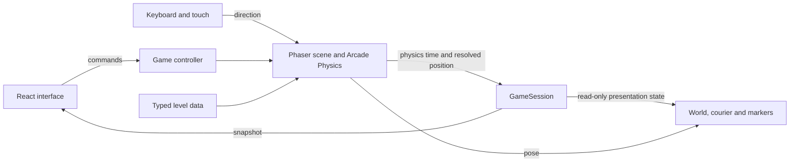

# Architecture

Parcel separates a small game's reusable foundation from its delivery example. Phaser owns the browser game loop and collision simulation. React presents controls and snapshots. No React render advances gameplay.

## Ownership

| Location                                                | Responsibility                                                                       |
| ------------------------------------------------------- | ------------------------------------------------------------------------------------ |
| `src/game/types.ts`, `levels.ts`                        | World dimensions, movement tuning, typed maps, and entity definitions                |
| `src/game/validateLevel.ts`                             | Map bounds, IDs, and walkable spawn/trigger positions                                |
| `src/game/session.ts`                                   | Pure delivery rules, inventory, phases, route time, and snapshots                    |
| `src/game/records.ts`                                   | Optional local best times and defensive storage access                               |
| `src/engine/contracts.ts`                               | Typed controller, options, and snapshot boundary                                     |
| `src/engine/createGame.ts`, `runtime.ts`                | Canvas capability check, lazy engine boot, controller, resize observer, and teardown |
| `src/engine/DeliveryScene.ts`                           | Scene composition, Arcade bodies, physics-step integration, and route restart        |
| `src/engine/controls.ts`                                | Keyboard/touch state, normalization, focus and visibility release                    |
| `src/engine/worldArt.ts`, `courierArt.ts`, `markers.ts` | Procedural presentation without deciding objectives                                  |
| `src/ui/useGame.ts`                                     | Engine attachment, async ownership, status/error handling, and cleanup               |
| `src/ui`                                                | Menus, route selection, objective feedback, settings, and touch controls             |

Snapshots contain copied player coordinates and delivered IDs. Consumers treat them as read-only. They do not expose a mutable Phaser scene or body to React. The controller is intentionally small: start/resume, pause, restart, select a route, set direction, set reduced motion, and dispose.

## The playable loop

Each route starts in `ready`. Starting moves it into `playing`. Walking onto the post office picks up the next parcel. Only the matching recipient accepts it; the post office cannot give a second parcel while one is carried. The last delivery changes the phase to `won` and updates the optional best time. Pause preserves progress; a new session resets route time and deliveries.

The session implements these rules without importing Phaser. Spatial consequences arrive through `visitPosition` after movement has been resolved by the engine. Buildings are solid. Roads and trees are art; the courier may cross grass. Proximity markers are separate from solid geometry.

Map validation is deliberately local: it rejects invalid dimensions, duplicate recipient IDs, and blocked key points. It cannot prove every route through arbitrary geometry is reachable. Actual control-based traversal remains necessary after layout changes.

## Time and presentation

The game uses a 960 by 640 logical world. Phaser fits that canvas into its measured parent; CSS chooses available space. World coordinates and movement speed do not change with the page's viewport size.

Arcade owns fixed physics stepping at 60 Hz. `DeliveryScene` reads controls at `PRE_UPDATE` and assigns velocity before the physics update. Its `WORLD_STEP` listener advances session time and checks the resolved body center. It does not also add velocity to the object's position. Pause clears input and stops the body; the session ignores elapsed steps while paused. A hidden page or unfocused window requires deliberate resume.

The HUD receives snapshots about every 100 milliseconds, with important transitions published immediately. Procedural presentation reads session state; a marker animation cannot award a delivery. Reduced motion changes decorative movement while retaining objective feedback.

## Lifetime boundaries

`useGame` owns one engine attachment per attempt. It ignores callbacks after cleanup, disposes a controller that resolves late, and creates a fresh owner on retry. React Strict Mode can mount and clean up a development effect twice; that must not leave two games or duplicate listeners.

External input listeners and layout observers belong to the integration owner. Scene-owned objects, bodies, and subscriptions belong to the scene. Restart and route switching clear held input and establish a new route session. Phaser 3.90 queues game destruction; callers must not stop its loop before the queued teardown can run. A replacement game remains possible because teardown preserves reusable Phaser plugins. Capture the Arcade world when attaching scene cleanup: its plugin may set `physics.world` to null before a later `SHUTDOWN` listener runs. Dereferencing that property during cleanup can interrupt restart and level changes.

The game host is focusable. Arrow/WASD capture applies to gameplay focus, while ordinary controls retain normal keyboard behavior. Touch actions use the same direction state and release on pointer-up, cancellation, lost capture, blur, and teardown. Pausing also clears held input so resume cannot inherit a stuck direction. Restart and route selection return to `ready`; the player starts the new run explicitly.

## Scope

This is a single-player, local game. Best times are editable client data. It does not include multiplayer synchronization, server authority, a level editor, an asset marketplace, or an entity-component framework. Add those when the requested product needs them. See [extension examples](extending.md), [research and sources](research.md), and [Amazi integration](amazi.md).
