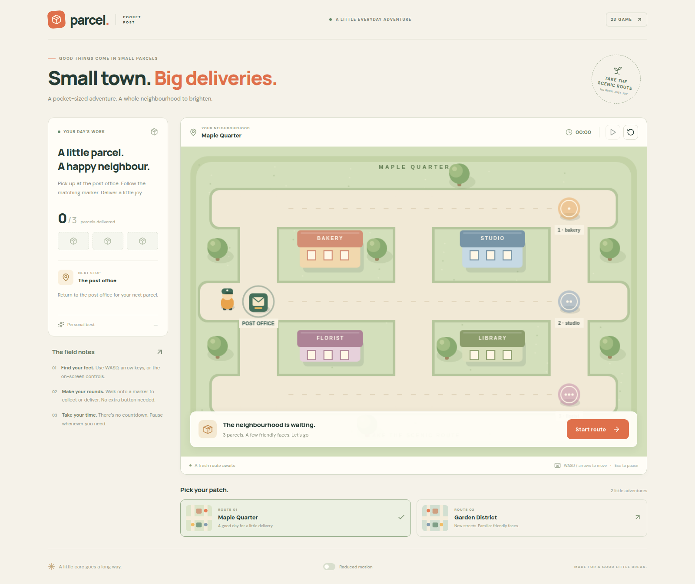

# Parcel — Pocket Post

This is the standalone application directory (`web/` in the example repository). Run the commands below from this directory, or use `pnpm --dir web` from the repository root. All build and runtime files are local to this directory.

A playable 2D delivery game and a small, reusable foundation for the next game.
Find your parcel at the post office, carry it through town, and deliver it to the matching address.
Two neighborhoods share the same game rules; maps and objectives are data.



## Run

Requires Node 22.12+ and pnpm 11.7.0 (pinned in `package.json`).

```bash
corepack enable
pnpm install --frozen-lockfile
pnpm dev
```

Open `http://localhost:4430`. Use WASD or arrow keys to move, Escape to pause, and the on-screen
controls on touch devices. Pickups and deliveries happen when you reach their marked stations.
Start, pause, restart, switch routes, and try to improve the best time saved on this device.
The game uses original procedural artwork; it needs no external media service or game account.

## Build and verify

```bash
pnpm format:check
pnpm typecheck
pnpm test
pnpm build
pnpm test:browser
```

Browser tests run against the production build and use Chrome at `/usr/bin/google-chrome`.
Set `CHROME_PATH` to your installed Chromium executable on another machine.
The test server uses Python 3 and port 4432. Tests drive real game controls and check game flow.

For a built desktop preview, run `python3 scripts/launch.py` after building. It opens
`http://127.0.0.1:4431` and starts an identity-checked local server. `--no-open` starts without a
window; `--stop` stops only the server owned by this launcher. This helper is optional and separate
from Amazi's production server.

## Make it your game

- [Architecture](docs/architecture.md): who owns state, timing, input, rendering, and cleanup.
- [Extending the example](docs/extending.md): add maps, mechanics, assets, or a different genre.
- [Advanced systems](docs/advanced-systems.md): gravity, rigid bodies, constraints, particles and effects.
- [Research and engine choice](docs/research.md): official examples and version-specific references.
- [Amazi application setup](docs/amazi.md): app registration, runtime tools, ports, and Docker.
- [Asset credits](docs/assets.md): artwork ownership and dependency licensing.

The UI is React; Phaser owns the game loop and Arcade Physics. Pure rules and map data stay
independent of either framework. Phaser 3.90 is deliberately pinned for this Canvas-based example;
see the research notes before changing engine versions or renderer.

The public template uses `main` as its default branch. Import this application directory into an Amazi application;
repository synchronization and application registration are separate steps. See the setup guide
for connecting your own output repository. A public game preview can be added after deployment.

## License

Original code and procedural art are MIT licensed. See [LICENSE](LICENSE).
Dependencies retain their own licenses; third-party example repositories are research references,
not copied game assets.
